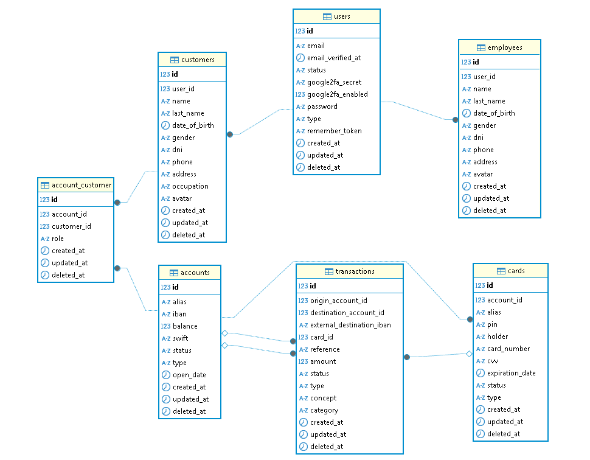

# 💳 Weft – Digital Neobank

## 📌 Project Description

**Weft** is a fully online neobank that allows users to manage their bank accounts easily and securely, without visiting physical branches. Designed to operate entirely remotely, Weft enables users to manage multiple accounts and even share accounts with other users.

Users can perform all types of banking transactions: deposits, withdrawals, internal and external transfers. These operations are handled in real-time via WebSockets, providing a fast and modern user experience. When a new user is created, an account and card are automatically generated so they can start operating immediately.

Weft features a comprehensive datatable to view sent and received transactions, with advanced search filters for easy tracking and financial control.

The application also includes a **cryptocurrency section**, currently allowing users to monitor real-time prices of major cryptos, with plans to support buying, selling, and transferring in the future.

---

## ✨ Key Features

- ✅ Automatic account and card creation upon registration.  
- 👥 Management of multiple accounts per user, including shared accounts with co-owners.  
- 🔁 Real-time banking transactions: deposits, withdrawals, internal and external transfers.  
- 📊 Datatable with transaction history and advanced filtering options.  
- 💹 Real-time cryptocurrency price tracking.  
- 🔐 Email verification and 2FA with OTP.  
- 🔁 Password recovery and change.  
- 📝 Update personal information at any time.  
- 🌐 Multilanguage support (English and Spanish).  
- 🌙 Dark mode for improved user experience.

---

## 🧩 Data Structure

The database is designed to clearly and scalably represent the relationships between users, accounts, and transactions. The main tables include:

- **`users`**: Core table storing login credentials (email, password, verification status, etc.).  
- **`customers`**: Stores personal user information separately from credentials.  
- **`accounts`**: Defines bank accounts with details such as balance, type, status, etc.  
- **`account_customers`**: Join table linking multiple customers to the same account.  
- **`cards`**: Cards associated with accounts, including number, expiration date, etc.  
- **`transactions`**: Logs of financial movements, including deposits, withdrawals, and internal/external transfers.

---

## 🧱 Project Architecture

The project follows the **Screaming Architecture** pattern, making it easy to understand the app’s core functionalities at a glance. It is modular, maintainable, and built to scale.

Business logic is organized in **decoupled services**, promoting reuse and allowing new features to be added without compromising system stability.

---

## 🛠️ Technologies Used

- **Frontend**: React + TailwindCSS  
- **Backend**: Laravel  
- **Realtime**: Laravel Reverb (WebSockets)  
- **Database**: MySQL  
- **Server**: NGINX  
- **Reverse Proxy & SSL**: NGINX Proxy Manager (NPM)  
- **Cloud Infrastructure**: AWS (EC2 and RDS)

---

## 🚀 Deployment

The application is deployed with the following setup:

- Frontend (React) and backend (Laravel) are served through an **NGINX** server acting as an internal proxy, routing requests between them.  
- The MySQL database is hosted on Amazon **RDS** for availability and scalability.  
- **NGINX Proxy Manager (NPM)** manages SSL certificates via Let’s Encrypt and acts as an external reverse proxy.  
- An AWS **EC2** instance hosts all services.

> For instructions on running the project locally using Docker, see the [`Deploy.md`](./Deploy.md) guide.

---

## 🔐 Test Credentials

You can use the following accounts to test the application:

| 📧 Email           | 🔑 Password |
|-------------------|------------|
| carlos@carlos.es   | 11111111   |
| laura@laura.es     | 11111111   |

---

## 🔮 Future Enhancements

> ⚠️ **Upcoming Feature – Fraud Detection:**  
> Development is underway on a **real-time fraud detection system** using **Machine Learning**. Once integrated, it will analyze transactions instantly and flag suspicious activity automatically, enhancing security and trust for users.  
> 🔗 [Fraud Detection Repository](https://github.com/ZuhirDev/ml-fraud-detection)

---

> ℹ️ *This project was developed for educational and learning purposes.